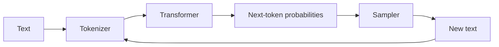
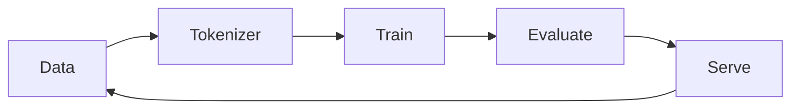
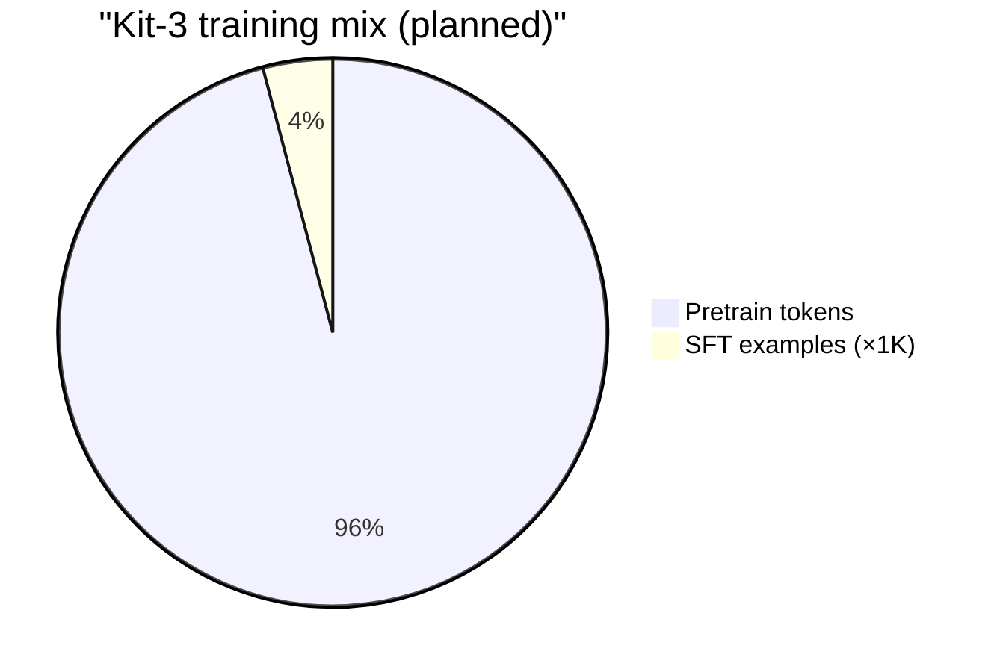

# Kit — A Language Model Built From Scratch


**Kit is a small decoder-only language model built from first principles in PyTorch: tokenizer, data pipeline, transformer, training loop, evaluation, and local serving — every release measured and reproducible.**

---

## What Kit does

```text
"Once upon a" → [tokens] → Kit → P(next token) → sample → repeat
```

- Predicts the next token from context.
- Trains on open text with a clean train / validation / test split.
- Samples with temperature, top-k, top-p, and repetition control.
- Serves locally via CLI, API, and a minimal web UI.
- Ships every version with a full spec sheet: params, tokens, FLOPs, loss, speed, memory, size.

---

## How it works





| Piece | What it is |
|---|---|
| Tokenizer | Byte-level BPE, frozen per model family |
| Model | Decoder-only transformer, pre-norm, tied embeddings |
| Training | AdamW, warmup + cosine, mixed precision, checkpoint + resume |
| Eval | Loss, perplexity, bits/byte, task rubrics, contamination check |
| Serve | KV-cache decoding, streaming API, quantized builds |

---

## Measured baseline

Real numbers from this repo (`scripts/check_env.py`):

| Test | Result |
|---|---|
| GPU | NVIDIA GeForce RTX 3050 6GB Laptop |
| VRAM | 6.0 GB total, 5.0 GB free |
| PyTorch | 2.11.0 + cu128, CUDA available |
| 10× matmul 4096×4096, CPU | 20.17 s |
| 10× matmul 4096×4096, GPU | 0.62 s |
| Speedup | **~32×** |

```text
CPU  ████████████████████████████████████████ 20.17s
GPU  █▌                                        0.62s
```

---

## Roadmap

| Version | Params | Data | Focus |
|---|---:|---|---|
| Kit-0 | ~4K | TinyShakespeare | next-token prediction |
| Kit-0.5 | ~13K | TinyShakespeare | backprop from scratch |
| Kit-1 | ~1.3M | TinyStories ~50M tokens | first transformer |
| Kit-2 | ~6.8M | TinyStories ~150M tokens | modern arch, ablations, scaling study |
| Kit-3 | ~17M | ~350M tokens + SFT | instruction following |
| Kit-4 | ~46M | ~800M tokens | local scale ceiling |

Each release gets a spec sheet in `specs/` with parameters, tokens, FLOPs, loss, perplexity, speed, memory, file size, and reproduction steps.



---

## Quickstart

```powershell
. .\scripts\env.ps1
.\.venv\Scripts\Activate.ps1

python -m kit.train --config configs/kit1.yaml
python -m kit.eval --checkpoint runs/.../best.pt --split test
python -m kit.sample --checkpoint runs/.../best.pt --prompt "Once upon a time"
python -m kit.serve --checkpoint runs/.../best.pt --port 8000
```

---

## Repo layout

```text
src/kit/       model, data, train, eval, sample, serve
configs/       run configs
tokenizer/     frozen tokenizer artifacts
specs/         spec sheets + model cards
scripts/       setup and benchmark helpers
labs/          from-scratch NumPy experiments
tests/         pytest
docs/          glossary and notes
notes/         build log
data/          datasets (local only, gitignored)
runs/          checkpoints and logs (local only, gitignored)
```

---

## Status

**Stage 0 complete:** environment on D:, PyTorch CUDA verified, GPU benchmark recorded, first commit tagged.

Next: character tokenizer → bigram → MLP → BPE → data pipeline → Kit-1 transformer.
